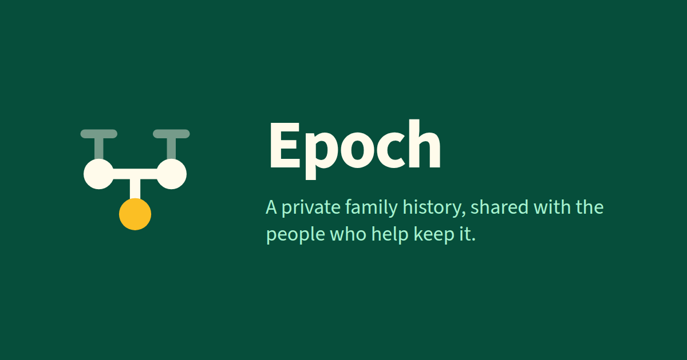

# Epoch Genealogy

A private family-tree application for one owner and the relatives and researchers they invite.
Each family runs its own copy on its own Cloudflare account, so no platform holds or mines the
data. Epoch is inspired by webtrees' capabilities, not its screens.

## Features

### A family tree that handles real families

- **More than one family per child.** A child can have more than one mother, father or parental
  family, each link typed as biological, adoptive, foster, guardian or unknown.
- **Partnerships, not just marriages.** Married and unmarried partners, separation, divorce,
  annulment, death, widowhood and remarriage. Repeated partnerships between the same two people
  stay distinct and are labelled "1st partnership", "2nd partnership", with dates.
- **Step relationships** are worked out from a parent's partnerships rather than entered by hand.
- **Honest dates.** Approximate, ranged, incomplete and conflicting dates are kept as written;
  `ABT 1900` never becomes an invented exact day.
- **Dates in words.** `ABT 1900` is shown as "about 1900" and `BET 1968 AND 1970` as "between 1968
  and 1970", in a format each tree chooses: 3 March 1900, March 3, 1900, 03 Mar 1900 or 03/03/1900.
  The stored text, search and GEDCOM export are unchanged.
- **Several names per person**, with types, components and a preferred display name, plus
  repeatable facts and events for people and partnerships.

### Exploring the tree

- An **Overview** tab that opens on the family's span, births by decade and surnames, with
  on-this-day and coming-up anniversaries, your open tasks and the latest changes.
- A focus-centred family view where generations up and down, siblings, step relatives and
  relationship types can be shown or hidden. The view is kept in the address, so reloading,
  **Back** and shared links restore it.
- **3D views** beside the flat view: **Rings** (one ring per generation), **Ball** (height is
  calendar time), **Ribbons** (lines of descent braiding at each partnership) and **Orrery**
  (partners as paired stars). Each can show the whole tree and trace several lines at once.
- **Charts** centred on any person: pedigree, descendants, fan and hourglass, each with a text
  outline.
- **Relationship finder** showing every route between two people.
- **Ranked search** over names, record ids, places and years, saying why each person matched.
- **Lists** of people, partnerships and surnames, paged on the server, plus recents and favourites.

### Records and research

- **Person pages:** names, facts (add, edit, remove, reorder), family, evidence, media and history.
- **Partnership pages:** partners, events, children, chronology, evidence and warnings.
- **Places** named by facts, with rename and merge.
- **Person pages** also show the age at each event, a Life timeline with children's births, and
  associations imported from GEDCOM on both people's pages.
- **Sources, repositories and citations**, showing what each source supports.
- **Shared notes**, and where each one is used.
- **Research tasks** with filters.
- A **data-quality report** that flags likely mistakes, with dismissals.
- **Media** attached to people, kept private in your own storage.

### Places and maps

- **A location for each place,** from the GEDCOM file's coordinates, an OpenStreetMap search or a
  pin dropped on the map. Setting, clearing or ignoring a location is logged and can be undone.
- **The Places tab is a map** with the list beside it, clustering places that sit close together.
  A place page shows its pin, and a person page maps the located facts of a life in order.
- **Place suggestions as you type,** the tree's own places first, then OpenStreetMap's.
- **Match places** looks up a tree's unlocated places in the background and lists the candidates,
  scored against the place text, for a manager to accept one by one or all the high matches at once.
- **Free OpenStreetMap services only:** Leaflet with OpenStreetMap tiles, and Photon for search,
  called through your own install. Only place text is sent, never a person, date or tree. Text that
  looks like a street address is never sent, and living people's homes are left off the maps.
- The install owner can turn geocoding off or point it at their own Photon server.

### Reports and printing

- A **Reports** hub under Research. Each report reads the tree as you may see it, so a printout never
  shows more than the screen.
- **About a person:** individual summary, ancestor and descendant narratives (Ahnentafel, d'Aboville
  or Henry numbering, with sources as numbered endnotes), relatives list, research gaps
  (completeness by generation and brick walls), evidence summary, an interview sheet to take to a
  relative, and a **family book** built from the sections you tick, with an index of names.
- **About a partnership:** the family group sheet.
- **Across the tree:** source usage, a place report including the places within a place, and a
  month calendar of anniversaries.
- **Downloads:** CSV from the source usage, place and calendar reports, and the anniversaries as an
  iCalendar (`.ics`) file.
- **Every page prints plainly:** no menus or buttons, black on white, with a footer naming the tree,
  the print date and your role, and page numbers in Chrome 131 or later.
- **Wall charts.** A chart prints landscape, and on A3 to A0 it is fitted to one sheet.
- **The flat tree as a poster.** Printing the family view draws every loaded card at full detail on
  one sheet cut to the drawing, from A4 up. Only the short side is held to A0's 841 mm, so a wide
  tree runs on as a banner for a plotter roll instead of shrinking. **Download PDF** saves the
  poster at its own size, for print dialogs that only offer the printer's paper.

### Editing safely together

- **Roles per tree:** owner, manager, editor, contributor and viewer.
- **Invitations.** Only the install owner, tree members and people with an open invitation can get
  in. Anyone else who signs in is told to ask the owner for an invitation, and nothing is stored
  about them.
- **Living-person privacy**, configured per tree by its managers.
- **Undo.** Every change is recorded in a change log, and each one shows a toast with **Undo**. Undo
  reverts your own latest change, and says why if someone else has since changed the same records.
- **Conflict protection.** If two people edit the same record at once, the second save is refused
  rather than overwriting the first.
- **Delete with impact.** Removing a person or link first shows exactly what will be affected.
- **Your own person.** Each member can say which person they are, and choose the person the tree
  opens on for them.

### GEDCOM import and export

- Import with validation and a **preview** before anything is written.
- **Duplicate families** in a messy file (same two partners, identical facts, no disagreement about
  a child) are offered for merging, on by default; **possible duplicates** are listed for review.
- **Merge duplicate partnerships** already in a tree from a partnership's menu, or **Merge…** in the
  person drawer. The dialog lists what moves or goes and asks you to choose where the facts differ.
  Merges can be undone.
- Export writes the tree back out, including structures Epoch does not yet show, which are kept
  from the import rather than discarded. Merged families keep their original ids.

## Roles

Each tree has five roles. Each role can do everything the role before it can, plus the additions
below.

| Role        | Adds                                                                                                                                                                      |
| ----------- | ------------------------------------------------------------------------------------------------------------------------------------------------------------------------- |
| Viewer      | Browse people, places, maps, charts and 3D views, search, and print and download the reports. Living and private people are hidden.                                       |
| Contributor | Add people, relationships, citations, notes and research tasks. You see living people you added, but private people stay hidden.                                           |
| Editor      | Change or delete any record, set a place's map location, import GEDCOM and upload media. You see everyone, can read the change log and can undo your own changes.         |
| Manager     | Invite people and change the roles of editors, contributors and viewers. Decide who is private, set tree options such as the date format, match places to map locations, export GEDCOM and undo anyone's change. |
| Owner       | Invite managers and other owners, and delete the tree. A tree always keeps at least one owner.                                                                             |

The install owner is separate from tree roles: setup records you as the install owner, and you
invite everyone else from a tree's **Members** page.

## FAQ

What does it cost?

You pay Cloudflare directly for a paid Workers plan. There is no Epoch subscription.

Who can see my tree?

Only people you invite. Cloudflare Access handles sign-in, and anyone else who signs in is told to ask the owner for an invitation. Nothing is stored about them.

Can I bring my tree from other software?

Yes, through GEDCOM. Epoch validates the file, shows a preview before anything is written, and offers to merge duplicate families.

What happens to data Epoch doesn't support yet?

It is kept and written back on export.

What if two people edit the same person?

The first save wins and the second is refused, with an explanation. Undo reverts your latest change, and warns you if the records have changed since.

Do I need my own domain?

No. Setup can use a workers.dev address or an active domain on your
Cloudflare account.

Can I take my data with me?

Yes. Export GEDCOM at any time. `./setup teardown` removes only what setup created.

Is it open source?

Yes, under the GNU Affero General Public License, version 3 or later.

Does it work on a phone?

Record pages, lists and the family view have phone layouts, and Epoch installs as a home-screen
app with pull to refresh and an offline page. The 3D views suit larger screens.

How does it relate to webtrees?

Epoch is inspired by webtrees' capabilities, not its screens or code. It is a separate application that exchanges data with it through GEDCOM.

Can I print the tree?

Yes. Every page prints without the app's menus, the Reports hub has narratives, a family group
sheet and a family book, charts print as wall charts on A3 to A0, and the family view prints or
downloads as a PDF poster sized to the drawing.

Is it ready for real records?

Epoch is young and in active development. Known gaps are in [docs/backlog.md](./docs/backlog.md). Export GEDCOM regularly.

## Getting started

The button copies Epoch into your GitHub account and deploys it to a workers.dev address on your
Cloudflare account. Then open that address and finish on its setup page, which puts Cloudflare
Access in front of sign-in and records you as the owner. You need a paid Workers plan and a Zero
Trust organisation with a login method.

To use your own domain, run Epoch on your own machine, or have setup manage the install afterwards,
follow [INSTALL.md](./INSTALL.md).

## Developing Epoch

Commands, tests, deploy internals and data backfills are in
[docs](https://github.dack.com.au/epoch/) and [docs/development.md](./docs/development.md).

## Licence

Copyright (C) 2026 Troy Dack.

Epoch is free software: you can redistribute it and/or modify it under the terms of the GNU Affero
General Public License as published by the Free Software Foundation, either version 3 of the
License, or (at your option) any later version. It is distributed in the hope that it will be
useful, but WITHOUT ANY WARRANTY; without even the implied warranty of MERCHANTABILITY or FITNESS
FOR A PARTICULAR PURPOSE. See [LICENSE](./LICENSE) for the full terms.

If you run a modified copy that other people use over a network, the licence asks you to offer them
its source code (section 13).

The GEDCOM files under `test/data/` were generated by a language model as test data, not taken
from anyone's research, and are covered by the same licence.
